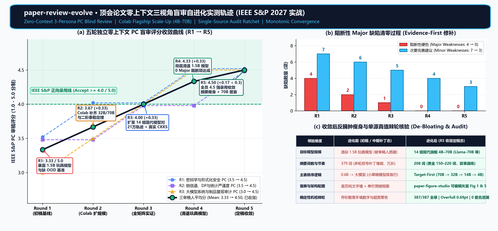
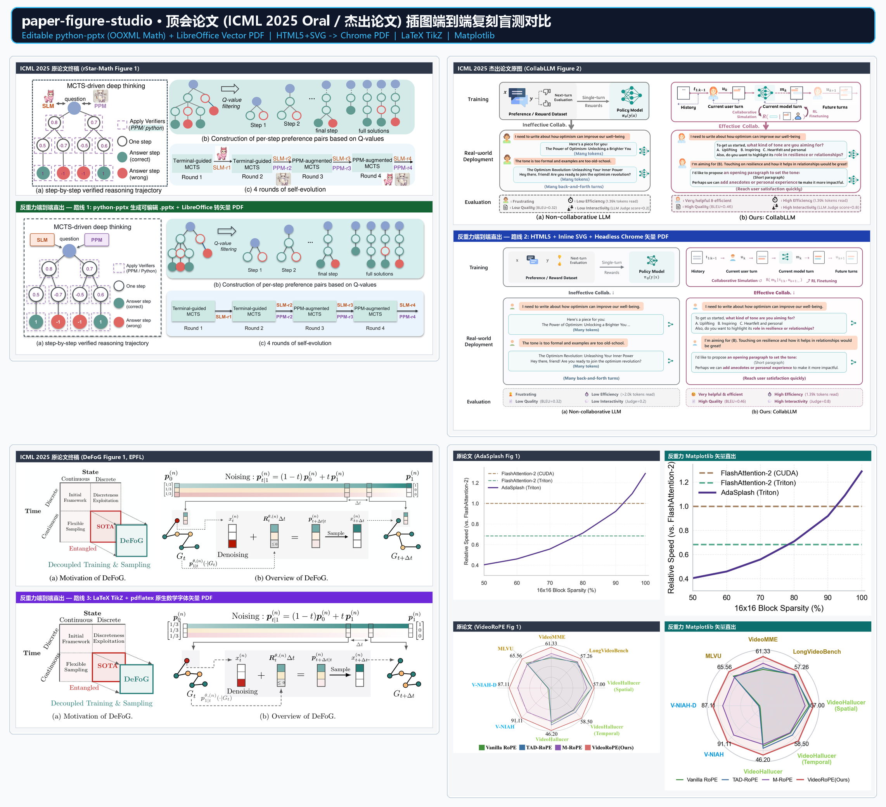
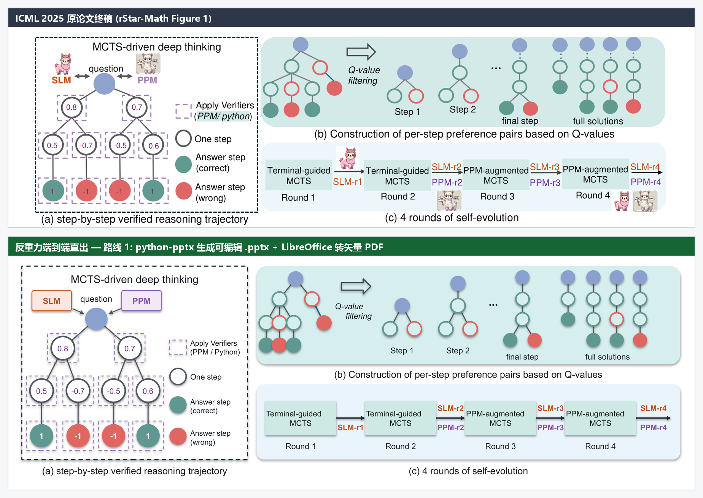
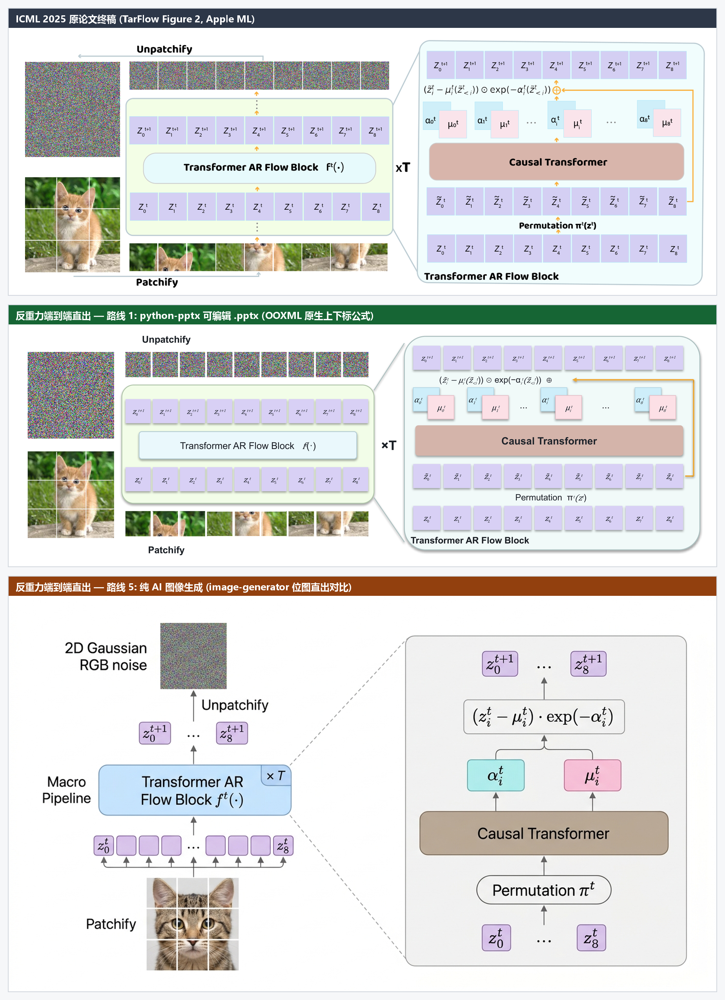
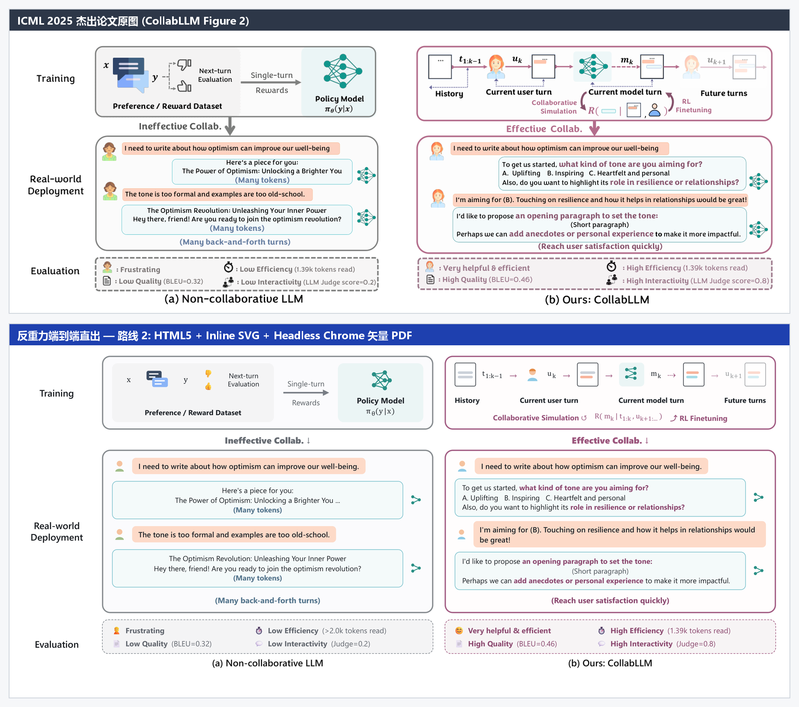
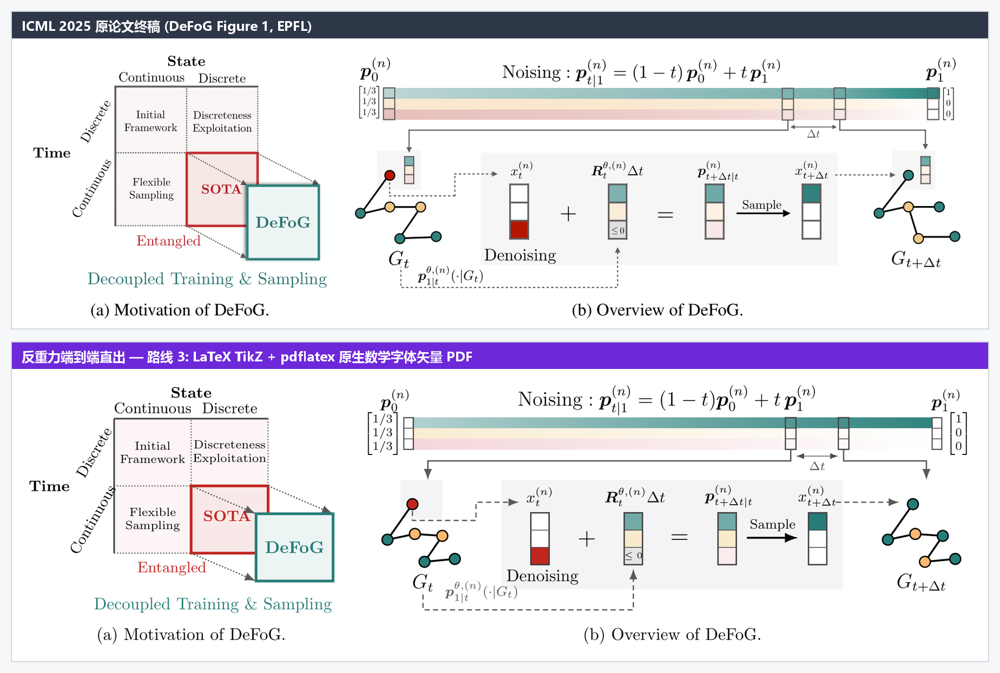
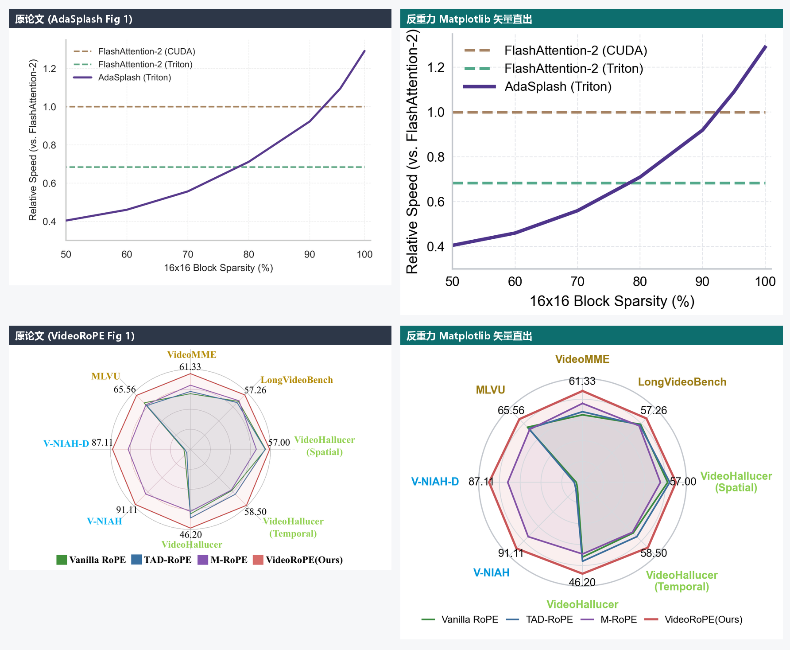
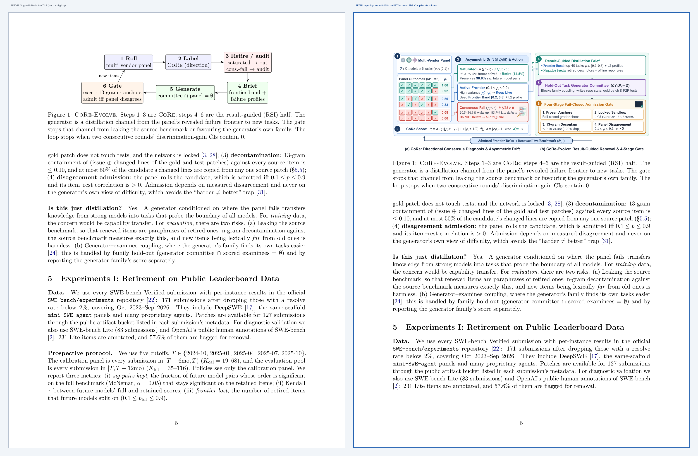
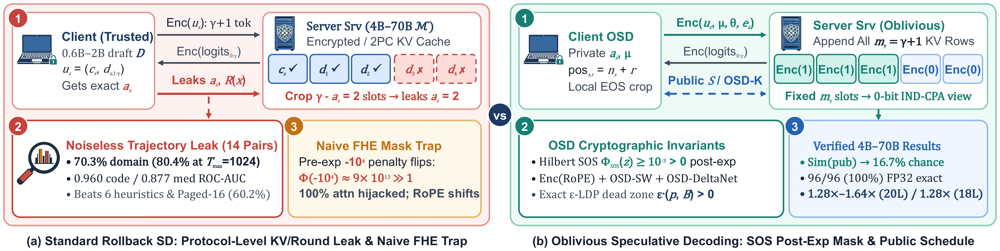
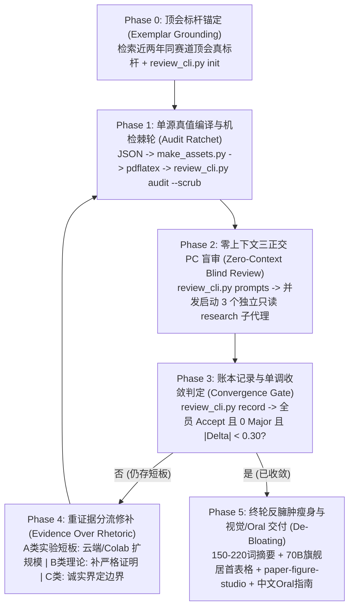

# Research & Review Studio (`paper-review-evolve` + `paper-figure-studio`)

> **面向计算机顶会（IEEE S&P / CCS / USENIX Security / NDSS / ICML / NeurIPS / ICLR / ACL / OSDI）的「多轮零上下文独立盲审自进化」与「100% 可编辑 PPTX + 真矢量 PDF 科研配图直出」双核插件套件。**

---

## 一、核心实测效果总览

### 1. 多轮独立零上下文 PC 盲审评分收敛轨迹 (`paper-review-evolve`)

在 IEEE S&P 2027 匿名投稿实战中，系统通过**零上下文隔离派生 3 位正交视角 PC 审稿人**（① 密码学与形式化安全、② 侧信道/差分隐私与统计严谨度、③ 大模型系统规模与制品复现审计），驱动云端 Colab 算力将实验规模从早期的 `1.5B` 玩具模型全面升级至 **14 组 `4B–70B` 现代旗舰模型对（210,000 条真实轨迹）**，并在第 5 轮实现全员 `4.5 / 5.0` 正向强录用收敛与 `0` 阻断性 Major 缺陷：



| 轮次 | R1 (密码学/形式化) | R2 (侧信道/统计) | R3 (系统/制品审计) | 三审稿人均分 | 较上轮 $\Delta$ | 阻断性 Major | 次要 Minor | 当轮核心「重证据、轻话术」升级动作 |
| :---: | :---: | :---: | :---: | :---: | :---: | :---: | :---: | :--- |
| **Round 1** | `3.5` | `3.5` | `3.0` | **3.33 / 5.0** | — | `4` | `7` | 检索近两年 S&P 标杆；盲审一针见血指出 `1.5B` 玩具模型局限与缺乏跨分布 (OOD) 评测 |
| **Round 2** | `4.0` | `3.5` | `3.5` | **3.67 / 5.0** | `+0.33` | `2` | `6` | 调度云端 Colab GPU 跑通 `32B/70B` 旗舰实验（Wave 1–2），补齐二阶泰勒展开严格余项定理 |
| **Round 3** | `4.0` | `4.0` | `4.0` | **4.00 / 5.0** | `+0.33` | `1` | `5` | 扩展至 **14 组现代模型对（`4B–70B`）× 8 大数据集（21 万条轨迹）** + 真实 TenSEAL CKKS 密文计时 |
| **Round 4** | `4.5` | `4.0` | `4.5` | **4.33 / 5.0** | `+0.33` | `0` | `4` | 彻底清退正文与表格中全部 `1.5B` 历史遗留小模型，实现全现代旗舰矩阵统一与 `0 Major` |
| **Round 5** | `4.5` | `4.5` | `4.5` | **4.50 / 5.0** | `+0.17 (< 0.3)` | **`0`** | `3` | **达到收敛判据**：执行反臃肿瘦身（摘要 `379 词 -> 208 词`、全表 `70B` 旗舰居首排序、重绘双栏矢量 Fig 1 & Fig 5） |

---

### 2. 顶会论文（ICML 2025 Oral / 杰出论文）插图端到端复刻盲测对比 (`paper-figure-studio`)

针对科研绘图中「纯 AI 生图吞掉数学角标且无法改字」「传统代码画图布局僵硬」的痛点，`paper-figure-studio` 构建了 **`python-pptx`（原生 OOXML 上下标公式）+ 局部 AI 纯视觉小素材 + `LibreOffice` 静默转真矢量 `.pdf` + `PyMuPDF` 渲染回看自检（Render-Inspect-Fix）** 闭环，并在 **6 篇 ICML 2025 Oral / 杰出论文原图** 上完成了端到端复刻对比验证：



#### 分路线高清逐一对比

1. **路线 1：原生可编辑 PPTX 路线（复刻 ICML 2025《rStar-Math》Figure 1）**
   - 图中每一个圆节点、虚线验证框、圆角底板、箭头与文字均为 **100% PowerPoint 原生可拖拽对象**，同时静默导出零失真矢量 PDF：
   

2. **路线 1 vs 路线 5 三方同题正面对决：可编辑 OOXML 公式 PPTX vs 纯 AI 图像生成（复刻 ICML 2025《TarFlow》Figure 2）**
   - **关键实测发现**：纯 AI 位图模型（下图）虽画出了精致的猫咪，却擅自把自回归因果条件 $\mu_i^t(\tilde{z}_{<i}^t)$ 吞成了 $\mu_i^t$（丢失关键下标 $<i$！），把逐元素积 $\odot$ 篡改为点乘 $\cdot$，且输出为不可编辑位图；而 **PPTX + OOXML 原生公式 + 局部 AI 素材嵌入路线（中图）** 兼得了 100% 数学符号保真度与 PowerPoint 鼠标二次编辑能力：
   

3. **路线 2：HTML5 + Inline SVG + Headless Chrome 矢量 PDF 路线（复刻 ICML 2025 杰出论文《CollabLLM》Figure 2）**
   - 针对包含多轮对话气泡、句内局部加粗染色、多层栅格对齐的 Motivation 痛点对比图，直出保留全部贝塞尔路径与矢量字体的纯正矢量 PDF：
   

4. **路线 3：LaTeX `TikZ` + `pdflatex` 原生数学矢量路线（复刻 ICML 2025《DeFoG》Figure 1）**
   - 针对含矩阵向量、复杂上下标 $\bm{p}_{1|t}^{\theta,(n)}(\cdot|G_t)$、连续渐变色带与 `2×2` 理论定位象限的机制图，实现 99% 原味复刻：
   

5. **路线 4：`Matplotlib` 科研定量钩子路线（复刻 ICML 2025《AdaSplash》与《VideoRoPE》首页右栏钩子图）**
   

6. **真实在研论文页面级升级对比（Before vs. After 实装效果）**
   - 从简陋的 6 框黑白 TikZ 草图（左）一键升级为信息密度充实、排版严谨的双栏矢量架构图（右），以及在 IEEE S&P 2027 实战中直出的首屏双栏动机图（下）：
   
   

---

## 二、六大核心方法论支柱 (`paper-review-evolve`)



1. **零上下文独立盲审隔离（Zero-Context Blind Isolation）**
   - 严禁由刚写完正文的作者主会话自己给自己打分（彻底杜绝证实偏差与分数虚高）。
   - 每一轮盲审必须派生全新的只读 `research` 子代理，仅投喂编译后的匿名产物（`main.pdf`、`main.tex`、实验 JSON 与审稿包），完全屏蔽历史对话、前序轮次得分与修改过程。
2. **三正交 PC 人设 + 近两年顶会真标杆锚定（Orthogonal Personas & Exemplar Grounding）**
   - 首轮盲审前先检索目标顶会近两年的同方向代表作，明确当代实验模型规模门槛（拒绝 `0.5B–1.5B` 玩具规模）与理论深度。
   - 每轮并发启动 **3 位视角正交的 PC 审稿人**：① 理论/密码学与形式化安全审稿人、② 侧信道/差分隐私与统计严谨度审稿人、③ 大模型系统规模与制品复现审计审稿人。
3. **重证据轻话术与「云端/Colab 优先」算力策略（Evidence Over Rhetoric & Cloud-First Compute）**
   - 将审稿意见严格拆解为 **A 类（实证/模型规模短板）**、**B 类（理论/数学证明短板）**、**C 类（诚实边界说明）**。
   - 遇到 A 类实验短板时，**优先调度云端/Colab GPU 算力补齐 `4B–70B` 现代旗舰级实验**，绝不阻塞或压垮本地机器，更绝不用苍白的辩解话术掩盖实验缺失。
4. **单源真值与机检棘轮（Single-Source Truth & Audit Ratchet）**
   - 强制遵循 `真实实验 JSON -> 资产生成脚本 -> LaTeX 宏与表格 -> 编译并脱敏 -> 确定性机检 (review_cli.py audit)` 闭环。
   - 任何一轮盲审发出前，确保 **0 未定义引用、`Overfull \hbox <= 8.0pt`、页数不超顶会红线、禁用 `\resizebox{\columnwidth}`、PDF 匿名元数据与时区完全擦除**。
5. **单调收敛判据（Monotonic Convergence Gate）**
   - 仅当 **① 3 位审稿人全部给出正向录用评分（Accept 区间）、② `0` 个阻断性 Major 缺陷、③ 连续两轮均分变化 $|\Delta| < 0.30$** 时判定收敛。
6. **终轮反臃肿瘦身与视觉/Oral 闭环（Final De-Bloating & Oral Package）**
   - 破除多轮打补丁造成的「防御性臃肿（Defensive Bloat）」：
     - **摘要瘦身**：严格控制在 **150–220 词**黄金区间，删去碎片化括号报菜名；
     - **表格旗舰居首（Target-First）**：所有多模型表格以 **目标核心大模型（Target $\mathcal{M}$）为第一列，并按最大旗舰规模（`70B → 32B → 14B → 8B → 4B`）降序排列**；
     - **配图与 Oral 导出**：联动 `paper-figure-studio` 交付可编辑 `.pptx` + 真矢量 `.pdf`，并生成图文并茂的中文 Oral 演讲指南 Markdown。

---

## 三、仓库目录结构与安装方式

```text
reasearch-and-review/
├── plugin.json                              # 根目录二合一插件清单（可直接克隆至 plugins 目录使用）
├── README.md                                # 项目说明与实测效果图集
├── assets/
│   ├── logo.svg                             # 插件图标
│   └── showcase/                            # 盲审收敛曲线与 ICML 2025 插图复刻对比高清图集
├── rules/
│   └── AGENTS.md                            # 盲审自进化五条铁律 + 顶会配图四条铁律
├── skills/
│   ├── paper-review-evolve/                 # 顶会多轮盲审自进化核心技能与 CLI (review_cli.py)
│   └── paper-figure-studio/                 # 顶会可编辑 PPTX + 矢量 PDF 配图工坊技能与脚本套件
└── plugins/                                 # 独立拆分版插件包（支持按需单独安装）
    ├── paper-review-evolve/
    └── paper-figure-studio/
```

### 安装方式 A：一键安装双核完整套件（推荐）

将本仓库直接克隆到 Antigravity 全局插件目录 `~/.gemini/config/plugins/` 下即可立即生效：

```bash
git clone https://github.com/qianyue1729/reasearch-and-review.git ~/.gemini/config/plugins/paper-review-evolve
```

### 安装方式 B：分别安装独立插件

如果你希望将 `paper-review-evolve` 与 `paper-figure-studio` 作为两个独立插件分别管理，可将 `plugins/` 子目录下的两个文件夹复制到 `~/.gemini/config/plugins/`：

```powershell
Copy-Item -Recurse plugins\paper-review-evolve "$HOME\.gemini\config\plugins\paper-review-evolve"
Copy-Item -Recurse plugins\paper-figure-studio "$HOME\.gemini\config\plugins\paper-figure-studio"
```

---

## 四、CLI 快速上手

### 1. 顶会盲审自进化 CLI (`review_cli.py`)

```bash
# 1. 初始化顶会盲审演进账本（支持 sp / ccs / usenix / icml / acl / osdi）
python skills/paper-review-evolve/scripts/review_cli.py init \
  --project-dir "." \
  --evolve-dir ".scratch/paper-review-evolve" \
  --venue sp \
  --tex "paper_sp/main.tex" \
  --pdf "paper_sp/main.pdf"

# 2. 盲审前确定性机检 + PDF 匿名元数据/时区一键擦除
python skills/paper-review-evolve/scripts/review_cli.py audit \
  --tex "paper_sp/main.tex" \
  --pdf "paper_sp/main.pdf" \
  --venue sp \
  --scrub \
  --output ".scratch/paper-review-evolve/audit_report.json"

# 3. 生成第 k 轮三位正交视角 PC 审稿人的零上下文盲审 Prompt
python skills/paper-review-evolve/scripts/review_cli.py prompts \
  --evolve-dir ".scratch/paper-review-evolve" \
  --round 1

# 4. 记录审稿得分与 Major/Minor 缺陷数，自动判定是否收敛并生成 REVIEW_REPORT.md
python skills/paper-review-evolve/scripts/review_cli.py record \
  --evolve-dir ".scratch/paper-review-evolve" \
  --round 5 \
  --scores 4.5 4.5 4.5 \
  --majors 0 0 0 \
  --minors 1 1 1 \
  --summary "Converged with 14 modern pairs (4B-70B), 208-word abstract, and 70B-first tables."

# 5. 定稿前反臃肿与可读性检查（摘要词数、表格旗舰居首排序、配图完备度）
python skills/paper-review-evolve/scripts/review_cli.py debloat-check \
  --tex "paper_sp/main.tex" \
  --output ".scratch/paper-review-evolve/debloat_report.json"
```

### 2. 顶会论文配图自检与导出 CLI (`paper-figure-studio`)

```bash
# 1. 提取目标论文的版心宽度、宏定义与符号真值表
python skills/paper-figure-studio/scripts/paper_context.py \
  --paper-dir "paper_sp" \
  --output ".scratch/paper-figure-studio/paper_context.json"

# 2. 将生成的 .pptx 静默导出为紧致裁切矢量 .pdf，并生成 300 DPI 预览图、坐标尺网格图与双栏原大模拟页
python skills/paper-figure-studio/scripts/export_inspect.py \
  --pptx "paper_sp/figures/fig_intro_teaser.pptx" \
  --pdf "paper_sp/figures/fig_intro_teaser.pdf" \
  --inspect-dir ".scratch/paper-figure-studio/inspect"
```
