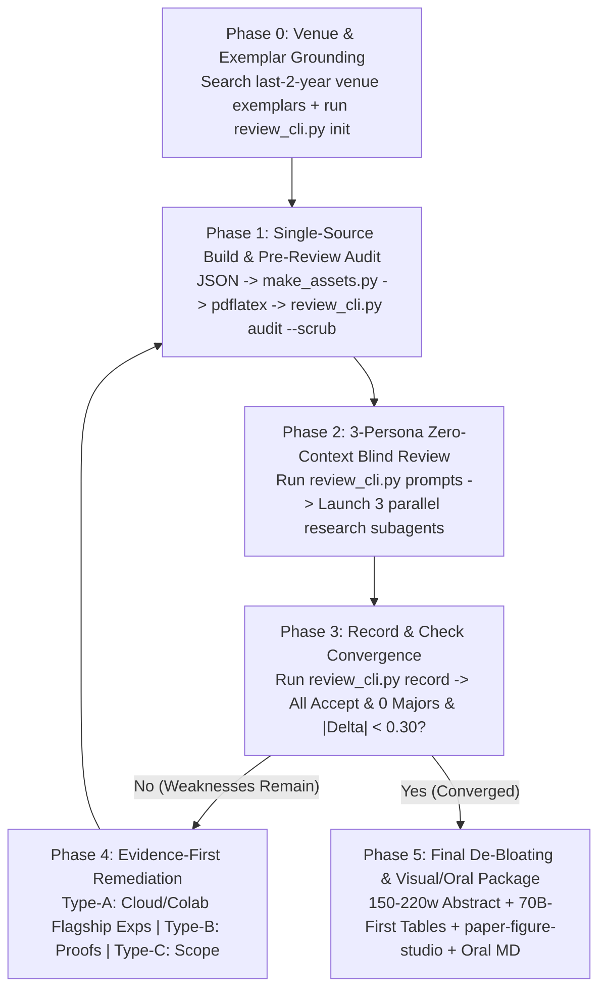

# Top-Venue Paper Blind Review & Self-Evolution (`paper-review-evolve`)

## Overview

When polishing an academic manuscript for top-tier conferences (`IEEE S&P`, `CCS`, `USENIX Security`, `ICML`, `NeurIPS`, `ICLR`, `ACL`, `OSDI`), authors and single-session AI agents frequently fall into three traps:
1. **Self-Review Confirmation Bias**: Evaluating one's own newly edited text inside the same conversation context inflates scores and misses fatal experimental or threat-model gaps.
2. **Toy-Model & Rhetoric Trap**: Answering reviewer critiques with defensive hand-waving instead of scaling experiments to modern flagship models (`14B–70B`) via cloud/Colab compute.
3. **Multi-Round Defensive Bloat**: Accumulating 350+ word abstracts packed with parenthetical patch notes and tables ordered by tiny helper models (`0.5B/1.5B -> ...`) rather than flagship targets (`70B -> 4B`).

This skill crystallizes a **6-stage closed-loop philosophy** backed by deterministic CLI tooling ([`review_cli.py`](file:///C:/Users/wxy12/.gemini/config/plugins/paper-review-evolve/skills/paper-review-evolve/scripts/review_cli.py)) and venue benchmarks ([`venue_profiles.md`](file:///C:/Users/wxy12/.gemini/config/plugins/paper-review-evolve/skills/paper-review-evolve/references/venue_profiles.md)).

---

## Dependencies

- **Python 3.9+** with `PyMuPDF` (`fitz`, optional but strongly recommended for PDF page inspection and in-place double-blind metadata scrubbing: `pip install pymupdf`).
- **LaTeX Toolchain**: `pdflatex` / `xelatex` + `bibtex` / `biber`.
- **Companion Skills** (invoke by name when needed):
  - `literature-search-arxiv` / `literature-search-openalex`: Retrieve recent (last 2 years) exemplar papers from the target venue before Round 1.
  - `browse` / Colab workflow: Dispatch heavy GPU experiments (`14B–70B` LLM evaluation, multi-seed sweeps, cryptographic benchmarks) to remote cloud/Colab GPUs without overloading the local machine.
  - `paper-figure-studio`: Create or upgrade the page-1 Intro Teaser (`fig1`) and Method Architecture figures using the editable `.pptx` + tight vector `.pdf` pipeline.

---

## Quick Start

```powershell
# 1. Initialize the evolution ledger for an IEEE S&P submission
python "C:\Users\wxy12\.gemini\config\plugins\paper-review-evolve\skills\paper-review-evolve\scripts\review_cli.py" init `
  --project-dir "." `
  --evolve-dir ".scratch/paper-review-evolve" `
  --venue sp `
  --tex "paper_sp/main.tex" `
  --pdf "paper_sp/main.pdf" `
  --exemplar " Carlini et al., IEEE S&P 2024 (Token-Length Side-Channel)" `
  --forbid-pattern "Qwen2\.5-1\.5B"

# 2. Run pre-review deterministic audit & in-place PDF metadata scrubbing
python "C:\Users\wxy12\.gemini\config\plugins\paper-review-evolve\skills\paper-review-evolve\scripts\review_cli.py" audit `
  --tex "paper_sp/main.tex" `
  --pdf "paper_sp/main.pdf" `
  --venue sp `
  --scrub `
  --output ".scratch/paper-review-evolve/audit_latest.json"

# 3. Generate 3 orthogonal zero-context PC reviewer prompts for Round 1
python "C:\Users\wxy12\.gemini\config\plugins\paper-review-evolve\skills\paper-review-evolve\scripts\review_cli.py" prompts `
  --evolve-dir ".scratch/paper-review-evolve" `
  --round 1

# 4. Record the 3 independent reviewers' scores and Major/Minor counts
python "C:\Users\wxy12\.gemini\config\plugins\paper-review-evolve\skills\paper-review-evolve\scripts\review_cli.py" record `
  --evolve-dir ".scratch/paper-review-evolve" `
  --round 1 `
  --scores 3.5 3.5 3.0 `
  --majors 1 1 2 `
  --minors 2 3 2 `
  --summary "Baseline blind review; identified 1.5B toy-model gap and missing OOD benchmarks."

# 5. Run final anti-bloat & readability check before freeze
python "C:\Users\wxy12\.gemini\config\plugins\paper-review-evolve\skills\paper-review-evolve\scripts\review_cli.py" debloat-check `
  --tex "paper_sp/main.tex" `
  --output ".scratch/paper-review-evolve/debloat_report.json"
```

---

## Utility Scripts

### [`scripts/review_cli.py`](file:///C:/Users/wxy12/.gemini/config/plugins/paper-review-evolve/skills/paper-review-evolve/scripts/review_cli.py)

| Subcommand | Purpose | Output Files |
| :--- | :--- | :--- |
| `init` | Initializes the multi-round convergence ledger with venue page limits, score thresholds, and 3 orthogonal PC personas. | `<evolve-dir>/review_ledger.json` |
| `prompts` | Generates 3 zero-context `research` subagent prompts tailored to the venue's 3 specialist personas. | `<evolve-dir>/round_<k>_prompts.json`, `<evolve-dir>/round_<k>_prompts.md` |
| `audit` | Verifies abstract word count, page limits, `Overfull \hbox <= 8.0pt`, zero undefined citations/refs, zero `\resizebox{\columnwidth}`, and double-blind PDF metadata anonymity (`--scrub` cleans in-place). | `--output <audit.json>` |
| `record` | Records Round `k` scores (`R1, R2, R3`) and Major/Minor counts, evaluates monotonic convergence, and renders the Markdown trajectory report. | `<evolve-dir>/review_ledger.json`, `<evolve-dir>/REVIEW_REPORT.md` |
| `debloat-check` | Audits final readability: abstract conciseness (`150–220` words), Target-First flagship-descending table row ordering (`70B -> 4B`), and figure companion assets. | `--output <debloat.json>` |
| `status` | Prints a quick one-line convergence summary from `review_ledger.json`. | Console summary |

---

## Workflow



### Phase 0: Venue & Exemplar Grounding
1. Consult [`references/venue_profiles.md`](file:///C:/Users/wxy12/.gemini/config/plugins/paper-review-evolve/skills/paper-review-evolve/references/venue_profiles.md) for the target venue's page limits, abstract word limits, and 3 orthogonal PC reviewer personas.
2. Search for 2–4 recent papers (published in the last 2 years at the target venue in the same sub-area) using `literature-search-arxiv`, `literature-search-openalex`, or `search_web` to anchor model scale expectations (e.g., `14B–70B` vs. outdated `1.5B` baselines), threat model rigor, and evaluation breadth.
3. Run `review_cli.py init` with `--venue`, `--tex`, `--pdf`, and `--exemplar`.

### Phase 1: Single-Source-of-Truth Build & Pre-Review Audit Ratchet
Before spawning any reviewer subagents, verify that the manuscript is self-consistent and passes all deterministic checks:
1. Regenerate all LaTeX macros, tables, and quantitative plots directly from raw experimental JSON outputs (e.g., `python src/make_sp_assets.py`). Never hand-edit numbers inside `.tex`.
2. Compile the PDF and scrub all identifying metadata (`Author`, `Creator`, `Producer`, `PTEX.Fullbanner`, and non-UTC timezone offsets in `CreationDate`/`ModDate`).
3. Run `review_cli.py audit --scrub` (plus any project-specific `audit*.py` scripts) and fix all failures until `status == "PASS"`.

### Phase 2: 3-Persona Zero-Context Blind Review
1. Run `review_cli.py prompts --round <k>` to generate the 3 specialist reviewer prompts.
2. Spawn **3 parallel `research` subagents** (`invoke_subagent(TypeName="research", Role=..., Prompt=...)`).
   - **CRITICAL ISOLATION RULE**: Each subagent starts with a clean context and reads **only** the compiled manuscript (`main.pdf`, `main.tex`, and supporting data/scripts). Never pass prior round scores, author excuses, or conversation history into the reviewer prompt.

### Phase 3: Triage & Evidence-First Remediation (Cloud/Colab Compute Priority)
1. Record the 3 reviewers' scores and Major/Minor counts via `review_cli.py record`.
2. If convergence is not yet reached, classify every Major and Minor weakness into three buckets:
   - **Type-A (Empirical / Scale / Baseline Gap)**: e.g., reliance on small `0.5B–1.5B` models, missing flagship `32B–70B` targets, missing OOD datasets (such as GSM8K/HumanEval/MT-Bench), or missing end-to-end cryptographic timing.
     - **Action**: Prioritize **remote Cloud/Colab GPU execution** (via `browse` / Colab notebook scripts or existing remote logs) to obtain real experimental measurements. **Never overload the local workstation with heavy LLM training/inference**, and never substitute defensive prose for missing experiments.
   - **Type-B (Theoretical / Mathematical Proof Gap)**: e.g., missing second-order Taylor remainder bound, unproved composition lemma, or loose DP/MI conversion.
     - **Action**: Derive and write the complete proof in the main text or Appendix, and cross-verify numerical bounds against the JSON data.
   - **Type-C (Scope & Threat-Model Calibration)**: e.g., claims that sound broader than the evaluated threat model.
     - **Action**: Explicitly state the scope boundary in the Abstract, Threat Model, and Discussion without weakening the core contribution.
3. Rebuild via Phase 1 and launch the next blind review round (`Phase 2`).

### Phase 4: Monotonic Convergence Gate
Stop the review-modify loop when `review_cli.py record` reports `converged: true`:
- All 3 orthogonal reviewers score at or above the venue's `accept_threshold` (e.g., `>= 4.0 / 5.0` for IEEE S&P/CCS/USENIX, or `>= 7.0 / 10.0` for ICML/NeurIPS/ICLR);
- **0 blocking Major weaknesses** across all 3 reviewers;
- Mean score change across the last two consecutive rounds satisfies $|\Delta| < 0.30$ (or all reviewers are at near-maximum `>= 4.75 / 5.0`).

### Phase 5: Final De-Bloating, Visual Upgrade & Oral Presentation Package
Multi-round review patching often leaves manuscripts accurate but bloated. Before declaring completion, execute the **4-step De-Bloating Checklist**:
1. **Abstract De-Bloating (`150–220` words)**:
   - Strip defensive parenthetical patch notes, metric catalog lists, and repetitive caveats accumulated across rounds.
   - Restore a punchy 4-part flow: *Context & Vulnerability/Problem -> Quantitative Discovery -> Core Method & Formal Guarantee -> Flagship Empirical Result*.
2. **Table Re-Ordering (`Target-First & Flagship-Descending`)**:
   - In multi-model or draft-target (`Mq -> M`) tables, always label the **Server Target Model $\mathcal{M}$ FIRST** (e.g., `Llama-3.3 70B (w/ Qwen3 0.6B draft)`) and order rows from the **largest flagship model (`70B`) down to the smallest (`4B`)** so reviewers immediately see flagship scale.
3. **Visual Polish via `paper-figure-studio`**:
   - Ensure the manuscript has a compelling page-1 Intro Teaser (`fig1`) and a clear Method Overview figure generated with `paper-figure-studio` (delivering both 100% editable `.pptx` and tight vector `.pdf` files, verified via `export_inspect.py`).
4. **Debloat Verification & Optional Oral Guide**:
   - Run `review_cli.py debloat-check --tex <main.tex>`.
   - When requested by the user, export 300 DPI PNGs of all figures and flagship tables and generate a comprehensive Chinese Oral Presentation Markdown guide (`oral_presentation_zh.md`) covering background glossary, motivation, method deep-dive, experimental walkthrough, and Q&A defense playbook.

---

## Common Mistakes

| Mistake | Why It Hurts | Correct Practice |
| :--- | :--- | :--- |
| **Author Self-Review** | Reviewing in the main agent session produces biased, lenient scores and misses real PC objections. | Always spawn 3 fresh `research` subagents using `review_cli.py prompts`. |
| **Defensive Prose Patching** | Adding 5 sentences of excuses for why only `1.5B` models were tested invites immediate rejection at S&P/ICML. | Upgrade the experimental suite on Colab/cloud (`4B–70B`) and purge legacy toy-model rows. |
| **Helper-First Table Labels** | Writing `0.6B -> 70B` or sorting `0.6B` rows at the top makes a flagship paper look like a `0.6B` toy study at a glance. | Put the target flagship model first (`Llama-3.3 70B (0.6B draft)`) and sort `70B -> 32B -> 14B -> 8B -> 4B`. |
| **350+ Word Abstract Bloat** | Reviewers lose the core narrative when every round's minor caveat is crammed into the abstract. | Enforce `150–220` words via `review_cli.py debloat-check`; move technical caveats to §Threat Model / §Discussion. |
| **`\resizebox{\columnwidth}` on Tables** | Shrinks wide tables to illegible 5pt text or inflates narrow tables to 12pt. | Use consistent `\footnotesize` or `\scriptsize` with `\setlength{\tabcolsep}{...}` and verify via `review_cli.py audit`. |
